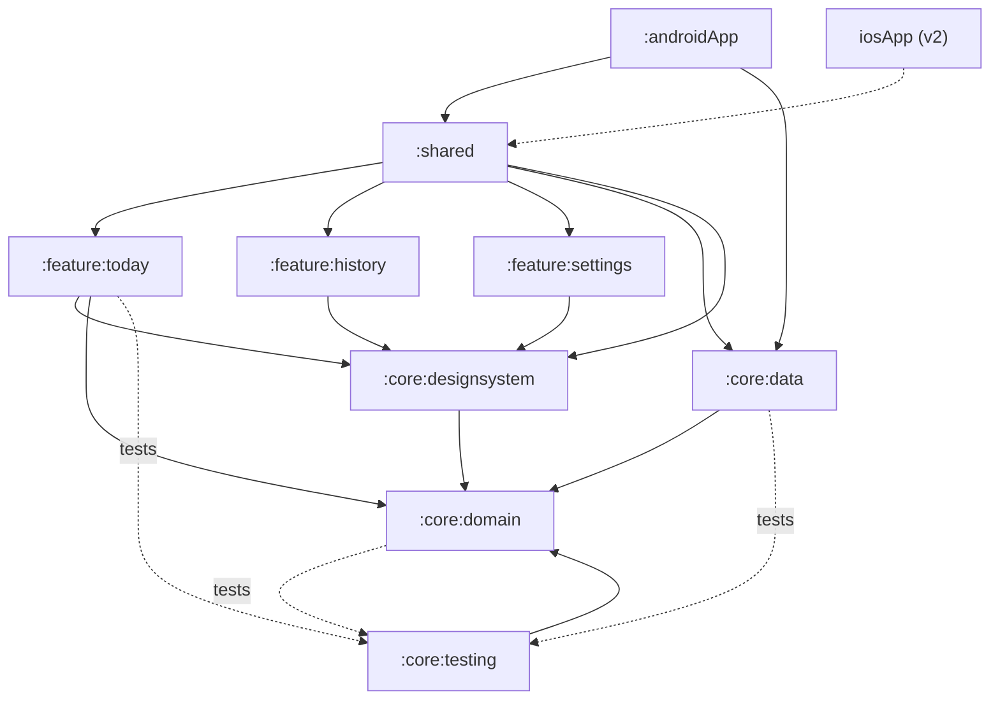

# ADR-0001: Architecture: KMP, Compose Multiplatform and MVI

Date: 2026-11-21 · Status: Accepted

## Context

Floorday is a consistency app (Minimum Day, medication reminders with insistent alarms, forgiving streaks). It ships on Android first, with closed testing in December 2026, and reaches iOS in March 2027 without rewriting the logic. One person builds it with few hours a week. The hard parts (logical day, streaks, reminder planning) are pure logic; the platform-dependent parts (alarms, notifications, widget, Health Connect) are small but critical. This ADR also absorbs ADR-0003 (MVI).

## Decision

1. **KMP from the first commit.** Targets: Android, `iosArm64` and `iosSimulatorArm64`, plus a test-only `jvm()` target in `:core:domain`, `:core:data` and `:core:testing` so database tests run on the host JVM. Versions live only in `gradle/libs.versions.toml`.
2. **Nine modules:** `:androidApp`, `:shared`, `:core:domain`, `:core:data`, `:core:designsystem`, `:core:testing`, `:feature:today`, `:feature:history` and `:feature:settings`. A feature never depends on another feature; `:core:domain` knows nothing about Room, Compose or Koin. Repeated build configuration lives in the `floorday.*` convention plugins, which also set every namespace from the module path.
3. **UI in Compose Multiplatform** in commonMain. UI strings in Compose resources (EN and ES); notification and widget strings in `:androidApp/res`.
4. **MVI.** `MviViewModel<S, I, E>` in `:core:designsystem`: one immutable state in a `StateFlow`, intents processed by a sequential queue (`handle`, `reduce`, `emit`, `currentState`), and one-shot effects only for navigation after business logic. Errors, undo and messages are state, not effects. A pure `Reducer` per screen is optional. Room flows are collected in `init` and folded into the state through `reduce`.
5. **Route/Screen.** `XRoute(callbacks)` gets the ViewModel, collects state and effects and calls its navigation callbacks. `XScreen(state, onIntent)` is stateless and previewable.
6. **Navigation 3 (JetBrains KMP).** The `@Serializable` keys (`TodayKey`, `HistoryKey`, `SettingsKey`) live in `:shared`, registered in one polymorphic `SerializersModule`. `NavDisplay` uses a manual `entryProvider {}` in `:shared` and two decorators, saveable state and `ViewModelStore`; the second one is mandatory so each entry owns its ViewModel. `koin-compose-navigation3` stays out (experimental API).
7. **Koin**, allowed only in `:feature:*`, `:shared` and `:androidApp`; forbidden in `:core:*`. `initKoin(platformModules, appDeclaration)` in `:shared` assembles `dataModule(platform)` and one module per feature; `:androidApp` passes its platform modules. `Clock` and `TimeZone` are only provided there.
8. **Persistence:** Room 3 with `BundledSQLiteDriver` and two DataStore files (user settings and internal state) in `:core:data`. Room entities never leave the module (detail in ADR-0002).
9. **Platform behind interfaces.** `DataPlatform` (database and DataStore locations) and, from S3, `ReminderScheduler`, `NotificationGateway`, `PermissionController` and friends are interfaces implemented in `:androidApp` (and in Swift for iOS). `TimeZoneProvider` lives in `core.domain.time`. `kotlin.time.Clock` is always injected.
10. **expect/actual** only for `expect object FloordayDatabaseConstructor` (Room requires it). From S1, the composables `rememberIs24HourFormat()` and `rememberFirstDayOfWeek()` in `:core:designsystem`. Anything else needs a new ADR.

## Alternatives considered

- **Hilt:** Android/JVM only; it would split dependency injection into two graphs.
- **Metro:** compile-time and KMP, but a compiler plugin tied to each Kotlin version. Revisit in v2 (ADR-0004).
- **SQLDelight:** mature, but Room 3 is the official option, known to the author and with exported-schema migration tests. Plan B is Room KMP 2.8 (ADR-0002).
- **Decompose / Voyager:** their own component lifecycle next to the Jetpack ViewModel; Voyager 1.1 is still beta.
- **Effects in a `SharedFlow`, or several StateFlows per screen:** lost or replayed events, and impossible states with no pure reducer to test.
- **Keys in each feature plus `koinEntryProvider`:** experimental API; postponed until there is a reason.

## Consequences

- Critical logic is tested in commonTest without an emulator; iOS only adds a host and system APIs.
- Every new navigation key must be registered in the `SerializersModule`; otherwise saving state fails on iOS. A test covers it.
- Database tests run in `jvmTest`, not in `androidHostTest`, because the bundled SQLite native library does not load there.
- Two exceptions to "stable only": material3 alpha and detekt alpha (build ADR).
- Modules are split further only when a concrete reason asks for it, each split in its own PR.

## Sources

- https://kotlinlang.org/docs/multiplatform/compose-navigation-3.html
- https://developer.android.com/topic/architecture/ui-layer/events
- https://developer.android.com/jetpack/androidx/releases/room3
- https://insert-koin.io/docs/reference/koin-compose/compose
