# Cómo trabajo con IA en Floorday

Floorday está construido por una sola persona (yo, Miguel, Android developer con 5 años de experiencia) con Claude Code como pareja de programación. Este documento explica cómo, con qué reglas y con qué controles. No es un descargo de responsabilidad: es parte del diseño del proyecto, igual que la arquitectura o el CI.

La idea en una frase: **la IA escribe mucho código, pero no decide nada que no pueda revertir un test, y todo lo que hace pasa por las mismas barreras que el código de una persona, más algunas propias.**

## El reparto: qué decido yo y qué hace la IA

| Siempre lo decido yo | Lo hace la IA, y yo lo reviso |
|---|---|
| Qué se construye y en qué orden (issues, sprints, alcance) | Plan de implementación de un issue |
| Arquitectura, dependencias y versiones (ADRs) | Borradores de ADR y design docs con alternativas |
| Permisos, `targetSdk`, firma y todo lo que ve Google Play | Código de producción y tests |
| Textos legales, disclaimer médico, ficha de Play | Textos de UI en ES y EN, que reviso |
| Reglas de la propia IA (`AGENTS.md`, `.claude/`) | Revisión de PRs (segunda opinión) |
| CI/CD, publicación, tags y merges | Auditorías de cumplimiento de Play |
| Cuándo algo está terminado | Verificación local y resumen de lo que queda |

La configuración de la IA y del CI/CD la escribo y la commiteo yo, sin coautoría de IA. Es la "constitución" del proyecto: las reglas no las escribe quien tiene que cumplirlas. Detalle en [politica-autoria.md](politica-autoria.md).

## El flujo, de issue a producción

```mermaid
flowchart LR
  A[Issue con criterios de aceptación] --> B[Plan de Claude]
  B -->|lo apruebo o lo corrijo| C[Implementación en rama]
  C --> D[Hooks: reglas duras al editar]
  D --> E[verify.sh: detekt y tests]
  E --> F[/revision-pr con revisor-kmp/]
  F --> G[Mi revisión línea a línea]
  G --> H[PR: CI pr-gate, pr-meta y commit-policy]
  H -->|rebase merge| I[main]
  I --> J[Release: tag mío, fastlane en CI]
```



1. **Issue.** Cada trabajo empieza en un issue del tablero con "qué" y "criterios de aceptación" verificables. Sin issue no hay código.
2. **Plan.** Claude lee el issue y el código afectado y propone un plan: ficheros, tests, riesgos. Para cambios de varios módulos, en modo plan, sin tocar nada. Yo lo apruebo, lo recorto o lo cambio. Aquí es donde más valor aporto y donde más errores se evitan.
3. **Implementación.** Claude implementa en pasos pequeños, con el test primero en la lógica de dominio. Las skills del proyecto (`/pantalla-mvi`, `/migracion-room`, `/cambio-alarmas`...) le dan el procedimiento exacto de cada tipo de cambio.
4. **Barreras automáticas mientras escribe.** Los hooks de Claude Code bloquean antes de escribir lo que el proyecto prohíbe (imports de Android en código común, `Clock.System`, permisos vetados en el manifest, edición a mano de esquemas Room) y revisan después de escribir (formato, textos sin traducir).
5. **Verificación.** `bash .claude/hooks/verify.sh` ejecuta detekt y los tests de los módulos tocados. Si Claude intenta terminar sin verificar, el hook `Stop` se lo recuerda.
6. **Revisión por IA.** `/revision-pr` lanza un subagente revisor de solo lectura, con otro modelo y otro contexto, que no vio cómo se escribió el código.
7. **Revisión humana.** Leo el diff completo. Con más atención: alarmas, migraciones, tiempo y zonas horarias, cualquier cosa que toque datos del usuario.
8. **PR y CI.** El PR pasa los mismos checks que cualquier otro: compilación, detekt, lint, tests, cobertura, grafo de módulos, manifest fusionado, páginas de 16 KB y la política de autoría.
9. **Merge y release.** Merge solo por rebase, con los `fixup!` ya aplicados (cada commit se conserva tal cual se validó). Los tags y la publicación son míos.

## Las capas de control

| Capa | Dónde | Qué hace |
|---|---|---|
| Instrucciones | `AGENTS.md`, `CLAUDE.md` | Arquitectura, convenciones, 10 reglas duras, definición de hecho |
| Reglas por ruta | `.claude/rules/*.md` | Se cargan solo al tocar esa zona (alarmas, Room, UI, tests, build, CI) |
| Procedimientos | `.claude/skills/*/SKILL.md` | Paso a paso de cada tipo de cambio, con checklist |
| Subagentes | `.claude/agents/*.md` | Revisor y auditor de solo lectura; escritor de tests que no puede tocar producción |
| Permisos | `.claude/settings.json` | Qué puede ejecutar sin preguntar, qué pregunta y qué no puede nunca (push forzado, publicar, leer secretos, editar la zona humana: la IA no escribe las reglas que la gobiernan) |
| Hooks de Claude Code | `.claude/hooks/` | Bloqueos antes de editar o commitear, revisión después de editar, recordatorio de verificar |
| Hooks de git | `.githooks/` | Conventional Commits y política de autoría (también con `--amend`), igual para mis commits |
| CI | `.github/workflows/` | La última palabra: nada entra en `main` sin pasar |

Cada regla importante está en al menos dos capas. Las instrucciones guían; los hooks, los permisos y el CI obligan. Un modelo puede ignorar una instrucción; no puede saltarse un `exit 2`.

## Cómo verifico lo que produce la IA

- **Tests como contrato.** La lógica de dominio (día lógico, rachas, planificador de alarmas) está cubierta en `commonTest` con reloj falso y casos de DST y cambio de zona. Si un test cambia en el mismo PR que el código, lo miro dos veces.
- **Tests que primero fallan.** Para un bug, Claude escribe primero el test que lo reproduce y me enseña que falla por el motivo correcto.
- **Fuentes oficiales.** Versiones, APIs y políticas de Play se comprueban en la documentación oficial y el enlace va en el PR. Una versión sin fuente no entra en el catálogo.
- **Segunda opinión independiente.** El revisor es un subagente con contexto limpio y herramientas de solo lectura.
- **Pruebas manuales donde los tests no llegan.** Alarmas en Xiaomi y Samsung reales, Doze forzado, reinicio, cambio de zona: checklist en cada PR de alarmas.
- **El resumen final.** Claude termina cada tarea diciendo qué verificó, qué no pudo verificar y qué debo mirar yo con más cuidado.

## Métricas

Cada commit de código lleva `Co-Authored-By: Claude <modelo> <noreply@anthropic.com>`, así que la proporción se calcula del propio historial:

```bash
bash .githooks/authorship-policy.sh metrics              # todo el repo
bash .githooks/authorship-policy.sh metrics v0.9.0..HEAD # desde una versión
```

El check `commit-policy` publica la tabla en el resumen de cada PR. Lo que miro, más allá del porcentaje:

| Señal | Cómo la obtengo | Qué me dice |
|---|---|---|
| Reparto por zona | `metrics` | Cuánto esfuerzo va a gobernar la IA (zona humana) frente a producir con ella (zona asistida). Por diseño todo el código es asistido: el porcentaje no mide calidad, las señales de abajo sí |
| PRs con cambios tras mi revisión | etiqueta `revision-humana-cambios` | Calidad del primer intento |
| Hallazgos del revisor por severidad | resumen de `/revision-pr` en el PR | Qué tipo de error comete la IA |
| Bugs escapados a producción por origen | etiqueta `bug` + commit que lo introdujo | Si las barreras funcionan |
| Entradas nuevas en errores aprendidos | [errores-aprendidos.md](errores-aprendidos.md) | Si el sistema aprende |

## Límites: dónde no uso IA o la uso con más freno

- **Decisiones de producto y de Play.** Qué se construye y qué se declara a Google lo decido yo, con la IA como redactora.
- **Alarmas de medicación.** Siempre en modo plan, siempre con checklist manual en dispositivos reales. Es la parte donde un fallo hace daño.
- **Migraciones de datos.** Una migración publicada no se toca nunca; cada una con test desde todas las versiones publicadas.
- **Secretos.** La IA no puede leer keystores, `local.properties`, `~/.gradle/gradle.properties` ni cuentas de servicio (reglas `deny`).
- **Publicar.** Tags, fastlane, merges y Play Console están vetados para la IA.

## Errores aprendidos

Cuando la IA se equivoca de una forma que puede repetirse, el error se apunta con su causa y la barrera que se añadió para que no vuelva a pasar. Es un registro vivo: [errores-aprendidos.md](errores-aprendidos.md).

## Reproducir este entorno

```bash
git clone https://github.com/MiguelAMialdeaDev/floorday && cd floorday
git config core.hooksPath .githooks   # hooks de git del repo
# Claude Code lee CLAUDE.md, .claude/settings.json, rules, skills, agents y hooks al abrir el repo.
# Recomendado: jq (los hooks también funcionan con node o python3), ktlint y detekt-cli en el PATH.
```

Otros agentes (Codex, Gemini CLI, Copilot, Cursor) leen `AGENTS.md`, que es la fuente común. Los hooks de git y el CI aplican la misma política a cualquier herramienta.
